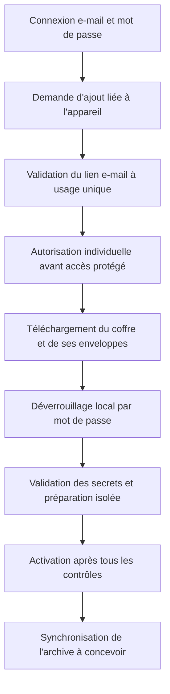

# CRYPTO-004 — Proposition d'architecture du coffre de récupération

**Statut au 13 novembre 2026 : décisions fonctionnelles confirmées ; conception cryptographique cible à valider, non implémentée.** Ce document décrit la cible actuelle et conserve les analyses de CRYPTO-004 et CRYPTO-005. Le coffre direct expérimental n'implémente pas cette cible.

La [spécification historique CRYPTO-006](recovery-vault-specification.md) et le [coffre direct V1](recovery-vault-direct-v1.md) restent des références expérimentales ; leurs formats à un seul accès ne définissent pas la nouvelle cible à deux enveloppes.

## Périmètre et parcours

La cible impose l'autorisation individuelle avant tout accès aux données protégées. Le parcours ne nécessite pas d'ancien appareil :

Les flèches décrivent des responsabilités, pas un protocole validé. En cas d'échec, ne pas exposer les secrets, activer l'appareil ou détruire les données précédentes. Le client ne doit pas traiter la connexion ordinaire comme une demande automatique de restauration.

### Comparaison historique de l'ordre d'autorisation

**Actualisation du 13 novembre 2026 :** l'option A ci-dessous est remplacée ; la cible retient l'autorisation préalable de l'option B, au moyen d'un lien e-mail lié à la demande. Ce contrôle n'est pas encore implémenté. La comparaison est conservée pour expliquer le compromis initial.

| Option                                                                    | Sécurité et disponibilité                                                                                                                                                                                                                                                                                                                 | Expérience et récupération sans ancien appareil                                                                                                                                                                           |
| ------------------------------------------------------------------------- | ----------------------------------------------------------------------------------------------------------------------------------------------------------------------------------------------------------------------------------------------------------------------------------------------------------------------------------------- | ------------------------------------------------------------------------------------------------------------------------------------------------------------------------------------------------------------------------- |
| **A — Compte, coffre, déchiffrement local, puis autorisation**            | Le coffre chiffré est accessible après authentification du compte, avant l'autorisation de l'appareil. Un compte compromis peut donc permettre sa copie et une attaque hors ligne ; le déchiffrement prouve la possession du secret mais ne doit pas autoriser automatiquement l'appareil. La vérification de fraîcheur reste nécessaire. | Un utilisateur ayant perdu tous ses appareils peut préparer sa récupération sans autorisation préalable, mais doit ensuite satisfaire la procédure d'autorisation individuelle.                                           |
| **B — Authentification renforcée et autorisation préalable, puis coffre** | Une barrière serveur supplémentaire peut réduire l'exposition du coffre, sous réserve de sa robustesse et de la confiance accordée au serveur. Elle ne protège pas un coffre déjà copié ni contre un serveur malveillant. Le moyen de preuve et son lien à l'appareil restent à concevoir.                                                | L'accès au coffre est retardé par l'autorisation. Si la procédure exige un appareil antérieur ou un facteur perdu, elle peut bloquer toute récupération ; une voie sans ancien appareil doit donc être définie et testée. |

La liaison du lien à la demande et à l'appareil, son expiration, son usage unique, la prévention des substitutions et rejeux, la reprise et le contrôle atomique des cinq places restent à concevoir et à tester. La validation e-mail est requise pour une nouvelle autorisation ; elle ne constitue pas à elle seule une preuve de déchiffrement ou une protection contre un serveur actif malveillant.

## Actifs, acteurs et limites de confiance

Actifs : identité durable, clés privées, clés et versions d'archive, secret de récupération, clés locales, liste et autorisations des appareils, état de fraîcheur du coffre et métadonnées. L'appareil autorisé traite ces données en clair ; le serveur conserve des enveloppes chiffrées et des métadonnées minimisées, pas les clés de déchiffrement.

Menaces : vol du coffre permettant des essais hors ligne, vol du secret, compromission du compte ou de l'appareil, substitution de compte ou de coffre, retour à un coffre ancien valide, rejeu ou concurrence de mises à jour, interruption, saisie erronée, accès non autorisé ou réutilisation d'un appareil révoqué. Un appareil compromis ou un utilisateur malveillant possédant le secret peut copier les données accessibles ; une révocation ne peut effacer ces copies. La perte de tous les moyens valides de déverrouillage et des appareils utilisables peut rendre le coffre irrécupérable.

La clé de récupération peut être volée indépendamment du mot de passe. Une prise de contrôle du compte peut tenter d'obtenir le coffre ; l'enregistrement d'un nouvel appareil doit être protégé séparément. Le serveur d'authentification reçoit le mot de passe sur TLS et n'en conserve qu'un vérificateur Argon2id. Un serveur activement compromis peut toutefois capturer le mot de passe et potentiellement ouvrir le coffre. Cette V1 n'offre donc pas les mêmes garanties contre la capture du mot de passe par le serveur qu'un protocole d'authentification renforcée de type OPAQUE. OPAQUE n'est pas retenu en V1 ; une évolution ultérieure reste facultative, sans composant ni migration anticipés.

## Proposition de hiérarchie et de format

**Cible confirmée :** générer une clé maître aléatoire indépendante du mot de passe et chiffrer localement le coffre avec authentification. Deux enveloppes distinctes et versionnées protègent cette même clé : l'une avec une clé dérivée côté client du mot de passe du compte, avec sel, paramètres et séparation de domaine indépendants du vérificateur serveur ; l'autre avec une clé issue de la clé de récupération aléatoire. Présenter cette dernière dès l'inscription et expliquer sa conservation hors du seul appareil. Aucun algorithme, paramètre de KDF, fournisseur ou format binaire définitif n'est choisi.

Les deux enveloppes étant des accès alternatifs à la même clé maître, une récupération forte ne compense pas un mot de passe faible. Les essais hors ligne dépendent notamment du mot de passe, du KDF et de ses paramètres ainsi que de l'accès aux enveloppes. La limitation serveur ne protège pas une copie déjà obtenue.

L'indépendance de la clé maître, le versionnement des enveloppes et l'isolation de la logique de déverrouillage doivent permettre conceptuellement un réenveloppement futur. Ils ne garantissent pas une migration vers OPAQUE et ne justifient ni mécanisme OPAQUE ni système générique de plugins en V1.

- Générer localement un secret aléatoire avec un CSPRNG fiable ; cible proposée d'au moins 128 bits d'entropie effective, avec encodage humain standardisé, vérification de saisie et conservation hors ligne. Ne pas utiliser une phrase choisie librement en lui attribuant cette entropie. La présentation, la normalisation, le contrôle d'erreur et l'accessibilité restent à évaluer ; un contrôle d'erreur ne crée pas d'entropie.
- Pour l'enveloppe de récupération, dériver ou obtenir une clé à partir de la clé aléatoire et de paramètres adaptés. Argon2id était une alternative étudiée dans la conception initiale ; CRYPTO-006 examine aussi HKDF pour un secret aléatoire fort, sans choix définitif. La dérivation par mot de passe est une opération distincte, résistante aux essais hors ligne et à mesurer sur les appareils cibles. Le [RFC 9106](https://www.rfc-editor.org/rfc/rfc9106.html) donne notamment une option pour mémoire réduite à 64 Mio, trois passes et quatre voies : ce n'est pas une validation de ces paramètres sur nos mobiles. La limitation des essais côté serveur ne bloque pas une attaque hors ligne après vol du coffre.
- Envelopper une clé de coffre aléatoire distincte, puis utiliser un chiffrement authentifié AEAD éprouvé pour protéger le contenu. AES-256-GCM ou XChaCha20-Poly1305 sont des candidats ; le choix, l'implémentation et la gestion des nonces restent à valider. Ne jamais réutiliser une paire clé/nonce ; le chiffrement AEAD ne fournit pas à lui seul l'anti-rejeu ni le contrôle d'accès. Voir [RFC 5116](https://www.rfc-editor.org/rfc/rfc5116.html) et [documentation libsodium XChaCha20-Poly1305](https://doc.libsodium.org/doc/secret-key_cryptography/aead/chacha20-poly1305/xchacha20-poly1305_construction).
- Prévoir une enveloppe versionnée avec identifiants de format et d'algorithmes, paramètres KDF bornés, sel, nonces, génération, référence de compte et données chiffrées et authentifiées. Lier cryptographiquement le contexte pertinent à l'enveloppe avec les données associées d'une API AEAD ou un format existant équivalent. Les paramètres lus avant authentification sont non fiables : vérifier leur structure et imposer des bornes de ressources avant dérivation, puis authentifier les valeurs effectivement utilisées. Le format exact, la sérialisation canonique et les règles de migration restent à spécifier et auditer.
- Contenu candidat : les deux paires composant l'identité durable choisie ; les clés racines ou versions nécessaires au déchiffrement de l'archive personnelle et leurs métadonnées de version ; les seules autres données durables indispensables à leur interprétation. Le contenu exact et la hiérarchie d'archive restent ouverts. Exclure les sessions et états de ratchet, les préclés, registration IDs et identifiants ou clés de stockage propres à un appareil. L'archive contient les données conservées et reste indépendante des clés de transport.

Cette proposition décrit une composition à évaluer, pas un nouveau standard ni une autorisation d'implémenter des primitives maison. Préférer un format et des bibliothèques existants et interopérables après validation des propriétés recherchées.

### Choix du secret et de la dérivation à évaluer

| Alternative                                                                          | Attaque hors ligne et entropie                                                                                                                                                               | Compromis mobile et humain                                                                                                                             |
| ------------------------------------------------------------------------------------ | -------------------------------------------------------------------------------------------------------------------------------------------------------------------------------------------- | ------------------------------------------------------------------------------------------------------------------------------------------------------ |
| **Secret aléatoire fort et dérivation adaptée**, par exemple HKDF                    | Un secret uniformément généré avec une entropie suffisante rend la recherche exhaustive coûteuse ; HKDF sépare des clés mais ne ralentit pas les essais et ne renforce pas un secret faible. | Calcul peu coûteux ; la saisie et la conservation d'un secret long restent difficiles. La qualité du CSPRNG et le format humain doivent être vérifiés. |
| **Secret aléatoire fort et Argon2id**                                                | Conserve la protection liée à l'entropie et augmente le coût par essai hors ligne ; Argon2id n'ajoute pas d'entropie.                                                                        | Coût supplémentaire en mémoire, temps et batterie ; tester les appareils les moins puissants et les interruptions.                                     |
| **Phrase choisie par l'utilisateur et Argon2id**, alternative historique non retenue | L'entropie réelle est inconnue et peut être faible ; Argon2id ralentit les essais mais ne rend pas une phrase prévisible équivalente à un secret aléatoire fort.                             | Cette alternative ne constitue pas la clé de récupération aléatoire décidée. Le mot de passe du compte protège l'autre enveloppe.                      |

Le secret aléatoire fort reste la proposition de référence ; les deux dérivations sont à comparer sans choisir de bibliothèque ou de paramètres définitifs. La conception doit respecter les décisions déjà documentées ou, si elle s'en écarte, faire l'objet d'une décision explicite. Voir [RFC 5869](https://www.rfc-editor.org/rfc/rfc5869.html) et [RFC 9106](https://www.rfc-editor.org/rfc/rfc9106.html).

## Intégrité, substitution et ancienne version

Le chiffrement authentifié doit refuser les données ou le contexte modifiés ; l'identifiant de compte attendu doit provenir d'une authentification vérifiée, puis être lié au coffre. Cela ne suffit pas si l'infrastructure malveillante peut mentir sur l'identité du compte ou présenter un ancien coffre valide. Le format, sa version et son contexte doivent aussi empêcher les substitutions entre comptes, coffres, usages et versions, sous les hypothèses de confiance retenues.

Une génération authentifiée et un journal ou point de contrôle indépendant peuvent aider à détecter un retour arrière lorsque le client possède une référence fiable. Un simple compteur stocké dans le coffre ou renvoyé uniquement par le même serveur potentiellement compromis ne prouve pas la fraîcheur. Sur un appareil vierge après perte de tous les appareils, sans point de contrôle de confiance indépendant, il est impossible de distinguer à coup sûr le dernier coffre d'un ancien coffre valide présenté par un serveur malveillant. Le choix des ancres, témoins éventuels, vérifications inter-appareils et du parcours en cas de doute reste bloquant ; un refus peut aussi rendre une récupération indisponible.

| Situation                                        | Garantie possible et limite                                                                                                                                                                                                                                                                                                               |
| ------------------------------------------------ | ----------------------------------------------------------------------------------------------------------------------------------------------------------------------------------------------------------------------------------------------------------------------------------------------------------------------------------------- |
| **Panne ou retour arrière accidentel**           | Une génération connue, des écritures durables, contrôles d'intégrité et historiques de versions peuvent détecter ou permettre de réparer certains retours arrière. Une panne peut rendre la version la plus récente indisponible ; la procédure ne doit pas la remplacer silencieusement.                                                 |
| **Serveur activement malveillant**               | Le chiffrement authentifié détecte une falsification, mais pas la présentation d'une ancienne version authentique. Un compteur ou journal contrôlé uniquement par ce serveur ne constitue pas une preuve indépendante ; il peut omettre ou présenter des vues divergentes.                                                                |
| **Au moins un appareil de confiance disponible** | Un point de contrôle récent conservé sur cet appareil peut détecter une version antérieure si son intégrité et le canal de comparaison sont vérifiés. Il ne prouve pas l'existence d'une mise à jour plus récente qu'il n'a jamais observée.                                                                                              |
| **Tous les appareils perdus**                    | Une référence indépendante préservée peut aider à vérifier la fraîcheur selon sa propre confiance et sa disponibilité. Sans référence indépendante fiable, il est impossible de garantir la détection d'un ancien coffre valide fourni par un serveur malveillant ; le risque, le refus ou la reprise devront être explicitement traités. |

## Rotation, panne et autorisation

Trois parcours sont distincts :

1. **Changement ordinaire avec mot de passe connu :** produire et vérifier une nouvelle enveloppe de la même clé maître ; les autres appareils restent connectés et autorisés. La révocation est une action séparée.
2. **Mot de passe oublié :** l'e-mail réinitialise l'authentification sans déchiffrer ni détruire le coffre. La clé de récupération, ou une intervention cryptographiquement valide d'un appareil encore autorisé, permet ensuite de retrouver la clé maître et de protéger une nouvelle enveloppe. Sans ces moyens, l'accès aux anciennes données ne peut pas être promis.
3. **Compromission :** distinguer changement préventif, mot de passe volé et appareil compromis. Une ancienne enveloppe copiée reste ouvrable avec son ancien secret ; un réenveloppement ne révoque pas les secrets déjà extraits. La rotation éventuelle des clés et leur distribution sûre restent à concevoir.

Le vérificateur serveur et l'enveloppe par mot de passe doivent évoluer avec versions, concurrence contrôlée et reprise sûre après panne. Leur publication et leur activation ne sont pas encore conçues comme transaction atomique ; conserver une voie de reprise sans retour arrière silencieux.

- Une modification de secret peut réenvelopper la même clé de coffre avec un nouveau sel et de nouveaux paramètres, après vérification du nouveau secret. Une ancienne copie de l'enveloppe reste déchiffrable avec l'ancien secret : ce réenveloppement ne révoque pas les copies volées. En cas de compromission, une rotation des clés concernées et, si nécessaire, le rechiffrement ou la migration de l'archive exigent une conception distincte ; les données déjà copiées restent exposées.
- Une rotation ou publication doit préparer une nouvelle version, la vérifier et la rendre durable avant activation, gérer les conflits entre appareils et les interruptions, et préserver une voie de reprise sans rétablir silencieusement une ancienne version. Les garanties transactionnelles du serveur, du coffre local et des fichiers ne sont pas encore établies ensemble.
- La possession de l'identité partagée ou du seul secret ne prouve pas l'autorisation individuelle. Le contrôle du compte, les preuves d'appareil, l'approbation du nouvel appareil, la limite de cinq, la révocation, les notifications et la reprise sans ancien appareil nécessitent une conception vérifiable. Une révocation ne supprime pas les secrets déjà copiés ; l'impact d'une compromission sur les futures clés d'archive et l'identité doit être résolu.
- Préparer les données dans un espace isolé non actif. Après panne ou résultat incertain, conserver l'état pour diagnostic, empêcher les écritures concurrentes et l'activation, et ne pas effacer ou remplacer automatiquement. L'import actuel ne fournit pas de création conditionnelle interprocessus ; **SEC-CRYPTO-002 reste bloquant**.

## Solutions à comparer

| Candidat                            | Intérêt                                                                                                            | Limites à vérifier                                                                                                                                                                                                                                                                                                                                        |
| ----------------------------------- | ------------------------------------------------------------------------------------------------------------------ | --------------------------------------------------------------------------------------------------------------------------------------------------------------------------------------------------------------------------------------------------------------------------------------------------------------------------------------------------------- |
| Libsodium et bindings natifs        | APIs Argon2id et AEAD établies ; implémentation native.                                                            | Choix et maintenance des bindings Node et React Native, formats et paramètres identiques, builds Expo et audit de l'intégration. La [documentation libsodium](https://doc.libsodium.org/password_hashing) décrit Argon2id ; elle ne valide pas un binding mobile particulier.                                                                             |
| `@noble/hashes` et `@noble/ciphers` | APIs JavaScript portables candidates, proches des dépendances déjà utilisées par le SDK.                           | Dépendances directes et versions à évaluer, limites mémoire et temps constant JavaScript, performances Argon2id sous Hermes ; [noble-hashes](https://github.com/paulmillr/noble-hashes) avertit de ses performances Argon2 en JavaScript. Aucune compatibilité Expo précise n'est démontrée.                                                              |
| Format age / bibliothèque rage      | Format existant documenté et chiffrement à phrase secrète, réduisant le besoin d'un format cryptographique propre. | Le [format age](https://github.com/C2SP/C2SP/blob/main/age.md) utilise scrypt pour les phrases secrètes ; compatibilité avec les hypothèses Argon2id du projet, liaison du contexte, rotation et intégration Node/Expo restent à étudier. [rage](https://github.com/str4d/rage) est une implémentation Rust ; les bindings mobiles ne sont pas démontrés. |
| API OpenE2EE `device`               | Bundle d'identité et chiffrement de transfert caractérisés lors de CRYPTO-003.                                     | Pas un coffre de récupération indépendant démontré : le transfert éphémère, l'authentification de l'ancien appareil, le rejeu et les données d'archive ne satisfont pas seuls le parcours visé.                                                                                                                                                           |

Aucun candidat n'est choisi définitivement. Ne pas importer les modules internes d'OpenE2EE ni considérer ses dépendances transitives comme des API Bunny Talks.

## Plateformes et validation requise

La même spécification doit pouvoir être relue sous Node et sur iOS et Android avec Expo Development Builds ; mesurer le CSPRNG, les paramètres KDF, la mémoire, la durée, l'interruption, le nettoyage et l'interopérabilité des implémentations. Le stockage local chiffré et la protection des clés doivent être testés avec SQLCipher, Keychain et Keystore ; aucun test Node ne prouve leur fonctionnement mobile. [Expo SecureStore](https://docs.expo.dev/versions/v55.0.0/sdk/securestore/) ne doit pas être la seule source d'une donnée irremplaçable et présente des comportements différents après désinstallation ou changement biométrique.

Avant production : vecteurs officiels et tests croisés, secret erroné ou mal saisi, corruption et substitution de champs, paramètres KDF abusifs, versions inconnues, ancien coffre valide, panne à chaque étape, accès concurrents, ajout et révocation, récupération après perte totale, rotation et ancien secret compromis, conservation de l'archive, tests natifs et revue de sécurité indépendante. **SEC-CRYPTO-002 et SEC-CRYPTO-003 restent ouverts et bloquants.**

## CRYPTO-005 — Évaluation des primitives, sans format définitif

**Statut :** caractérisation limitée sous Node, pour revue ; aucune primitive de coffre ni bibliothèque de production n'est retenue. Les tests utilisent explicitement `@noble/ciphers` et `@noble/hashes` 2.4.0 comme dépendances de développement, indépendamment des dépendances transitives du SDK. Ils ne constituent pas un audit ni une validation mobile.

### Candidats et frontières publiques

- **Noble 2.4.0 :** les exports publics `@noble/hashes/hkdf.js` et `sha2.js` fournissent HKDF-SHA-256 ; `@noble/hashes/argon2.js` expose Argon2id ; `@noble/ciphers/aes.js` expose `gcm`, et `chacha.js` expose `xchacha20poly1305`. Leurs déclarations acceptent les octets de contexte AEAD. Ils sont en JavaScript, sous licence MIT et requièrent Node ≥ 20.19 ; le mainteneur annonce React Native avec un fournisseur aléatoire si nécessaire, mais Hermes et Expo du projet ne sont pas testés. Le SDK dépend déjà de ces familles de bibliothèques, ce qui ne rend pas leurs modules internes ou leurs dépendances transitives publics pour Bunny Talks.
- Les audits cités par les mainteneurs concernent des versions antérieures : [noble-ciphers 1.0.0](https://github.com/paulmillr/noble-ciphers#security) et [noble-hashes 1.0.0](https://github.com/paulmillr/noble-hashes#security) ; ce dernier excluait Argon2. Ils ne valident pas les versions 2.4.0 ni notre intégration. Le compilateur JIT et le ramasse-miettes empêchent de promettre un temps constant ou l'effacement complet ; l'implémentation AES de Noble utilise des tables dont les accès peuvent révéler des informations temporelles. Les performances et la mémoire d'Argon2id JavaScript doivent être mesurées sur mobile.
- **Libsodium :** les fonctions publiques `crypto_pwhash` et `crypto_aead_xchacha20poly1305_ietf_*` offrent respectivement Argon2id et AEAD avec données associées ; son implémentation AES-GCM dépend de l'accélération matérielle prise en charge. Le projet est maintenu et distribué sous [licence ISC](https://github.com/jedisct1/libsodium/blob/master/LICENSE). Sa [documentation AEAD](https://doc.libsodium.org/secret-key_cryptography/aead) et ses [API XChaCha20-Poly1305](https://doc.libsodium.org/doc/secret-key_cryptography/aead/chacha20-poly1305/xchacha20-poly1305_construction) ne prouvent pas que des bindings précis fonctionnent avec notre version d'Expo/Hermes. Par exemple, [react-native-libsodium](https://github.com/sodium-friends/react-native-libsodium) est sous licence MIT et n'expose qu'un sous-ensemble des fonctions ; sa maintenance, ses versions natives et sa compatibilité restent à examiner. Les bindings Node/iOS/Android retenus et leurs licences nécessitent une évaluation distincte.
- **OpenE2EE 14.4.0 :** licence MIT ou Apache-2.0 ; les opérations publiques `device` servent au transfert et ne constituent pas une API générique validée de coffre durable avec contexte authentifié et KDF de récupération. Aucun module interne n'est proposé comme dépendance.

### Dérivation et chiffrement

Pour un secret réellement aléatoire d'au moins 128 bits d'entropie effective, HKDF-SHA-256 est un candidat pour dériver des clés séparées par usage à l'aide de contextes `info` distincts et non ambigus. HKDF n'ajoute pas d'entropie et ne ralentit pas les essais ; une longueur de 16 octets ne prouve pas que le secret est aléatoire. Argon2id peut augmenter le coût de chaque tentative hors ligne, mais n'ajoute pas non plus d'entropie et entraîne des coûts mémoire, temps et batterie. Les étiquettes, la normalisation du secret, le sel et les versions doivent être définis et authentifiés dans une future spécification, sans réutilisation entre coffre et archive. Voir [RFC 5869](https://www.rfc-editor.org/rfc/rfc5869.html) et [RFC 9106](https://www.rfc-editor.org/rfc/rfc9106.html).

AES-256-GCM utilise ici une clé de 32 octets et un nonce de 12 octets ; XChaCha20-Poly1305 utilise une clé de 32 octets et un nonce de 24 octets. La non-répétition d'une paire clé/nonce reste obligatoire : un nonce aléatoire long diminue le risque de collision mais ne dispense pas d'une source aléatoire fiable ni d'une politique de limites d'usage. AES-GCM doit également respecter ses limites d'utilisation et une stratégie de nonce explicitement validée. Les erreurs d'authentification doivent être traitées sans divulguer secret ni données en clair. L'AAD lie un contexte au ciphertext, mais ne démontre ni la fraîcheur, ni l'autorisation de l'appareil, ni la sûreté en cas de réutilisation de nonce. Les propriétés de robustesse multi-clés doivent aussi être étudiées si un attaquant peut influencer les clés candidates : voir [limites AEAD libsodium](https://doc.libsodium.org/secret-key_cryptography/aead).

Le profil candidat à évaluer associe HKDF-SHA-256 à XChaCha20-Poly1305 : secret de récupération produit par un CSPRNG avec au moins 128 bits d'entropie effective, clé AEAD de 32 octets et nonce de 24 octets issu d'un CSPRNG. Les contextes de dérivation doivent être distincts, non ambigus et versionnés ; les données associées doivent authentifier le contexte défini par la future spécification. Des limites explicites sur les entrées, le ciphertext et les paramètres devront être contrôlées avant allocation et traitement cryptographique. Leurs valeurs, le format et la sérialisation restent à définir en revue.

Ces hypothèses supposent une génération et une conservation sûres du secret : une copie volée ou un secret prévisible ne sont pas protégés par HKDF. L'effacement des tableaux mutables est au mieux une réduction de l'exposition : copies, ramasse-miettes, optimisations et mémoire interne du moteur JavaScript empêchent de garantir l'effacement ou le temps constant. Les essais Node utilisent son CSPRNG et son moteur JavaScript ; ils ne démontrent rien sur le fournisseur d'entropie ou l'exécution sous Hermes. Des Expo Development Builds réels sur iOS et Android devront vérifier le CSPRNG, les exports et dépendances natives, les vecteurs et échanges croisés, les performances, interruptions et comportements du stockage sécurisé.

### Résultats et limites des tests

Les tests `recovery-primitives-evaluation.test.ts` vérifient sous Node un vecteur HKDF-SHA-256 du RFC 5869, un vecteur public AES-256-GCM et le ciphertext et le tag du vecteur AEAD XChaCha20-Poly1305 de l'[Internet-Draft CFRG expiré, annexe A.3.1](https://datatracker.ietf.org/doc/html/draft-irtf-cfrg-xchacha-03#appendix-A.3.1). Ils vérifient aussi l'interopérabilité AES-GCM Noble/`node:crypto`, la séparation de contextes et le rejet d'un mauvais secret ou clé, d'un ciphertext tronqué ou modifié, d'un tag, d'un nonce ou d'un contexte modifié et de certaines tailles invalides. Ils vérifient les API des bibliothèques, pas un coffre Bunny Talks. Une clé AES invalide est rejetée lors de l'opération de chiffrement dans le cas testé, pas nécessairement à la création du chiffreur.

L'API générique `gcm` accepte aussi des clés et des nonces d'autres tailles ; elle ne garantit donc pas à elle seule le profil AES-256-GCM avec nonce de 12 octets. Une future frontière applicative devra vérifier explicitement le profil retenu, les versions et les limites avant de dériver ou déchiffrer.

Aucun format ni registre de versions n'étant implémenté, le rejet des versions inconnues et les limites applicatives contre les tailles abusives ne sont pas encore testables ; ils restent des exigences avant une implémentation du coffre. Aucun test croisé libsodium n'a encore été ajouté. Le vecteur XChaCha provenant d'un Internet-Draft expiré est une référence indépendante, pas une RFC publiée. La génération mobile des secrets et nonces, l'interopérabilité Hermes/iOS/Android, la reprise et la résistance aux attaques hors ligne restent à vérifier. Des exemples de contexte et de nonce dans les tests ne définissent aucune convention de production.
