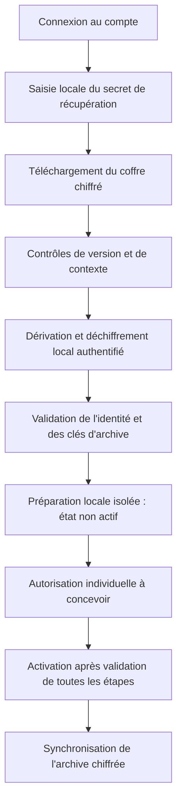

# CRYPTO-004 — Proposition d'architecture du coffre de récupération

**Statut : proposition pour revue, non validée et non implémentée.** La décision fonctionnelle est l'ajout principal d'un appareil par connexion au compte et secret de récupération, sans ancien appareil. L'autorisation individuelle reste obligatoire ; le QR est facultatif et reporté.

## Périmètre et parcours

Le schéma illustre l'option A ci-dessous. L'ordre entre autorisation et accès au coffre n'est pas encore choisi ; l'option B doit également être évaluée.

Les flèches décrivent des responsabilités, pas un protocole validé. En cas d'échec, ne pas exposer les secrets, activer l'appareil ou détruire les données précédentes. Le client ne doit pas traiter la connexion ordinaire comme une demande automatique de restauration.

### Autorisation avant ou après accès au coffre

| Option                                                                    | Sécurité et disponibilité                                                                                                                                                                                                                                                                                                                 | Expérience et récupération sans ancien appareil                                                                                                                                                                           |
| ------------------------------------------------------------------------- | ----------------------------------------------------------------------------------------------------------------------------------------------------------------------------------------------------------------------------------------------------------------------------------------------------------------------------------------- | ------------------------------------------------------------------------------------------------------------------------------------------------------------------------------------------------------------------------- |
| **A — Compte, coffre, déchiffrement local, puis autorisation**            | Le coffre chiffré est accessible après authentification du compte, avant l'autorisation de l'appareil. Un compte compromis peut donc permettre sa copie et une attaque hors ligne ; le déchiffrement prouve la possession du secret mais ne doit pas autoriser automatiquement l'appareil. La vérification de fraîcheur reste nécessaire. | Un utilisateur ayant perdu tous ses appareils peut préparer sa récupération sans autorisation préalable, mais doit ensuite satisfaire la procédure d'autorisation individuelle.                                           |
| **B — Authentification renforcée et autorisation préalable, puis coffre** | Une barrière serveur supplémentaire peut réduire l'exposition du coffre, sous réserve de sa robustesse et de la confiance accordée au serveur. Elle ne protège pas un coffre déjà copié ni contre un serveur malveillant. Le moyen de preuve et son lien à l'appareil restent à concevoir.                                                | L'accès au coffre est retardé par l'autorisation. Si la procédure exige un appareil antérieur ou un facteur perdu, elle peut bloquer toute récupération ; une voie sans ancien appareil doit donc être définie et testée. |

Aucune option n'est choisie définitivement. L'authentification renforcée de B reste un mécanisme à définir, sans présumer d'un MFA disponible en V1. Dans les deux options, l'activation de l'appareil, la limite de cinq et l'accès aux échanges futurs exigent une autorisation individuelle distincte de la possession des clés. Les décisions doivent tenir compte du coût utilisateur, des attaques hors ligne et de la récupération après perte totale.

## Actifs, acteurs et limites de confiance

Actifs : identité durable, clés privées, clés et versions d'archive, secret de récupération, clés locales, liste et autorisations des appareils, état de fraîcheur du coffre et métadonnées. L'appareil autorisé traite ces données en clair ; le serveur conserve des enveloppes chiffrées et des métadonnées minimisées, pas les clés de déchiffrement.

Menaces : vol du coffre permettant des essais hors ligne, vol du secret, compromission du compte ou de l'appareil, substitution de compte ou de coffre, retour à un coffre ancien valide, rejeu ou concurrence de mises à jour, interruption, saisie erronée, accès non autorisé ou réutilisation d'un appareil révoqué. Un appareil compromis ou un utilisateur malveillant possédant le secret peut copier les données accessibles ; une révocation ne peut effacer ces copies. La perte simultanée des appareils utilisables et du secret peut rendre le coffre irrécupérable.

Un secret de récupération peut être volé indépendamment du mot de passe. À l'inverse, une prise de contrôle du compte peut exposer le coffre chiffré et déclencher des tentatives de récupération ; l'enregistrement d'un nouvel appareil doit être protégé séparément. Le modèle de confiance et la résistance à un serveur malveillant restent à valider.

## Proposition de hiérarchie et de format

- Générer localement un secret aléatoire avec un CSPRNG fiable ; cible proposée d'au moins 128 bits d'entropie effective, avec encodage humain standardisé, vérification de saisie et conservation hors ligne. Ne pas utiliser une phrase choisie librement en lui attribuant cette entropie. La présentation, la normalisation, le contrôle d'erreur et l'accessibilité restent à évaluer ; un contrôle d'erreur ne crée pas d'entropie.
- Dériver une clé d'enveloppement à partir du secret et d'un sel aléatoire unique. Argon2id est le candidat cohérent avec la conception actuelle ; ses paramètres exacts doivent être mesurés sur les appareils cibles et versionnés. Le [RFC 9106](https://www.rfc-editor.org/rfc/rfc9106.html) donne notamment une option pour mémoire réduite à 64 Mio, trois passes et quatre voies : ce n'est pas une validation de ces paramètres sur nos mobiles. La limitation des essais côté serveur ne bloque pas une attaque hors ligne après vol du coffre.
- Envelopper une clé de coffre aléatoire distincte, puis utiliser un chiffrement authentifié AEAD éprouvé pour protéger le contenu. AES-256-GCM ou XChaCha20-Poly1305 sont des candidats ; le choix, l'implémentation et la gestion des nonces restent à valider. Ne jamais réutiliser une paire clé/nonce ; le chiffrement AEAD ne fournit pas à lui seul l'anti-rejeu ni le contrôle d'accès. Voir [RFC 5116](https://www.rfc-editor.org/rfc/rfc5116.html) et [documentation libsodium XChaCha20-Poly1305](https://doc.libsodium.org/doc/secret-key_cryptography/aead/chacha20-poly1305/xchacha20-poly1305_construction).
- Prévoir une enveloppe versionnée avec identifiants de format et d'algorithmes, paramètres KDF bornés, sel, nonces, génération, référence de compte et données chiffrées et authentifiées. Lier cryptographiquement le contexte pertinent à l'enveloppe avec les données associées d'une API AEAD ou un format existant équivalent. Les paramètres lus avant authentification sont non fiables : vérifier leur structure et imposer des bornes de ressources avant dérivation, puis authentifier les valeurs effectivement utilisées. Le format exact, la sérialisation canonique et les règles de migration restent à spécifier et auditer.
- Contenu candidat : les deux paires composant l'identité durable choisie ; les clés racines ou versions nécessaires au déchiffrement de l'archive personnelle et leurs métadonnées de version ; les seules autres données durables indispensables à leur interprétation. Le contenu exact et la hiérarchie d'archive restent ouverts. Exclure les sessions et états de ratchet, les préclés, registration IDs et identifiants ou clés de stockage propres à un appareil. L'archive contient les données conservées et reste indépendante des clés de transport.

Cette proposition décrit une composition à évaluer, pas un nouveau standard ni une autorisation d'implémenter des primitives maison. Préférer un format et des bibliothèques existants et interopérables après validation des propriétés recherchées.

### Choix du secret et de la dérivation à évaluer

| Alternative                                                             | Attaque hors ligne et entropie                                                                                                                                                               | Compromis mobile et humain                                                                                                                                      |
| ----------------------------------------------------------------------- | -------------------------------------------------------------------------------------------------------------------------------------------------------------------------------------------- | --------------------------------------------------------------------------------------------------------------------------------------------------------------- |
| **Secret aléatoire fort et dérivation adaptée**, par exemple HKDF       | Un secret uniformément généré avec une entropie suffisante rend la recherche exhaustive coûteuse ; HKDF sépare des clés mais ne ralentit pas les essais et ne renforce pas un secret faible. | Calcul peu coûteux ; la saisie et la conservation d'un secret long restent difficiles. La qualité du CSPRNG et le format humain doivent être vérifiés.          |
| **Secret aléatoire fort et Argon2id**                                   | Conserve la protection liée à l'entropie et augmente le coût par essai hors ligne ; Argon2id n'ajoute pas d'entropie.                                                                        | Coût supplémentaire en mémoire, temps et batterie ; tester les appareils les moins puissants et les interruptions.                                              |
| **Phrase choisie par l'utilisateur et Argon2id**, alternative à évaluer | L'entropie réelle est inconnue et peut être faible ; Argon2id ralentit les essais mais ne rend pas une phrase prévisible équivalente à un secret aléatoire fort.                             | Potentiellement plus mémorisable, avec risque de choix faible ou de perte ; nécessite une politique utilisateur, des mesures mobiles et une analyse spécifique. |

Le secret aléatoire fort reste la proposition de référence ; les deux dérivations sont à comparer sans choisir de bibliothèque ou de paramètres définitifs. La conception doit respecter les décisions déjà documentées ou, si elle s'en écarte, faire l'objet d'une décision explicite. Voir [RFC 5869](https://www.rfc-editor.org/rfc/rfc5869.html) et [RFC 9106](https://www.rfc-editor.org/rfc/rfc9106.html).

## Intégrité, substitution et ancienne version

Le chiffrement authentifié doit refuser les données ou le contexte modifiés ; l'identifiant de compte attendu doit provenir d'une authentification vérifiée, puis être lié au coffre. Cela ne suffit pas si l'infrastructure malveillante peut mentir sur l'identité du compte ou présenter un ancien coffre valide. Le format, sa version et son contexte doivent aussi empêcher les substitutions entre comptes, coffres, usages et versions, sous les hypothèses de confiance retenues.

Une génération authentifiée et un journal ou point de contrôle indépendant peuvent aider à détecter un retour arrière lorsque le client possède une référence fiable. Un simple compteur stocké dans le coffre ou renvoyé uniquement par le même serveur potentiellement compromis ne prouve pas la fraîcheur. Sur un appareil vierge après perte de tous les appareils, sans point de contrôle de confiance indépendant, il est impossible de distinguer à coup sûr le dernier coffre d'un ancien coffre valide présenté par un serveur malveillant. Le choix des ancres, témoins éventuels, vérifications inter-appareils et du parcours en cas de doute reste bloquant ; un refus peut aussi rendre une récupération indisponible.

| Situation                                        | Garantie possible et limite                                                                                                                                                                                                                                                                                                               |
| ------------------------------------------------ | ----------------------------------------------------------------------------------------------------------------------------------------------------------------------------------------------------------------------------------------------------------------------------------------------------------------------------------------- |
| **Panne ou retour arrière accidentel**           | Une génération connue, des écritures durables, contrôles d'intégrité et historiques de versions peuvent détecter ou permettre de réparer certains retours arrière. Une panne peut rendre la version la plus récente indisponible ; la procédure ne doit pas la remplacer silencieusement.                                                 |
| **Serveur activement malveillant**               | Le chiffrement authentifié détecte une falsification, mais pas la présentation d'une ancienne version authentique. Un compteur ou journal contrôlé uniquement par ce serveur ne constitue pas une preuve indépendante ; il peut omettre ou présenter des vues divergentes.                                                                |
| **Au moins un appareil de confiance disponible** | Un point de contrôle récent conservé sur cet appareil peut détecter une version antérieure si son intégrité et le canal de comparaison sont vérifiés. Il ne prouve pas l'existence d'une mise à jour plus récente qu'il n'a jamais observée.                                                                                              |
| **Tous les appareils perdus**                    | Une référence indépendante préservée peut aider à vérifier la fraîcheur selon sa propre confiance et sa disponibilité. Sans référence indépendante fiable, il est impossible de garantir la détection d'un ancien coffre valide fourni par un serveur malveillant ; le risque, le refus ou la reprise devront être explicitement traités. |

## Rotation, panne et autorisation

- Une modification de secret peut réenvelopper la même clé de coffre avec un nouveau sel et de nouveaux paramètres, après vérification du nouveau secret. Une ancienne copie de l'enveloppe reste déchiffrable avec l'ancien secret : ce réenveloppement ne révoque pas les copies volées. En cas de compromission, une rotation des clés concernées et, si nécessaire, le rechiffrement ou la migration de l'archive exigent une conception distincte ; les données déjà copiées restent exposées.
- Une rotation ou publication doit préparer une nouvelle version, la vérifier et la rendre durable avant activation, gérer les conflits entre appareils et les interruptions, et préserver une voie de reprise sans rétablir silencieusement une ancienne version. Les garanties transactionnelles du serveur, du coffre local et des fichiers ne sont pas encore établies ensemble.
- La possession de l'identité partagée ou du seul secret ne prouve pas l'autorisation individuelle. Le contrôle du compte, les preuves d'appareil, l'approbation du nouvel appareil, la limite de cinq, la révocation, les notifications et la reprise sans ancien appareil nécessitent une conception vérifiable. Une révocation ne supprime pas les secrets déjà copiés ; l'impact d'une compromission sur les futures clés d'archive et l'identité doit être résolu.
- Préparer les données dans un espace isolé non actif. Après panne ou résultat incertain, conserver l'état pour diagnostic, empêcher les écritures concurrentes et l'activation, et ne pas effacer ou remplacer automatiquement. L'import actuel ne fournit pas de création conditionnelle interprocessus ; **SEC-CRYPTO-002 reste bloquant**.

## Solutions à comparer

| Candidat                            | Intérêt                                                                                                            | Limites à vérifier                                                                                                                                                                                                                                                                                                                                        |
| ----------------------------------- | ------------------------------------------------------------------------------------------------------------------ | --------------------------------------------------------------------------------------------------------------------------------------------------------------------------------------------------------------------------------------------------------------------------------------------------------------------------------------------------------- |
| Libsodium et bindings natifs        | APIs Argon2id et AEAD établies ; implémentation native.                                                            | Choix et maintenance des bindings Node et React Native, formats et paramètres identiques, builds Expo et audit de l'intégration. La [documentation libsodium](https://doc.libsodium.org/password_hashing) décrit Argon2id ; elle ne valide pas un binding mobile particulier.                                                                             |
| `@noble/hashes` et `@noble/ciphers` | APIs JavaScript portables candidates, proches des dépendances déjà utilisées par le SDK.                           | Dépendances directes et versions à évaluer, limites mémoire et temps constant JavaScript, performances Argon2id sous Hermes ; [noble-hashes](https://github.com/paulmillr/noble-hashes) avertit de ses performances Argon2 en JavaScript. Aucune compatibilité Expo précise n'est démontrée.                                                              |
| Format age / bibliothèque rage      | Format existant documenté et chiffrement à phrase secrète, réduisant le besoin d'un format cryptographique propre. | Le [format age](https://github.com/C2SP/C2SP/blob/main/age.md) utilise scrypt pour les phrases secrètes ; compatibilité avec les hypothèses Argon2id du projet, liaison du contexte, rotation et intégration Node/Expo restent à étudier. [rage](https://github.com/str4d/rage) est une implémentation Rust ; les bindings mobiles ne sont pas démontrés. |
| API OpenE2EE `device`               | Bundle d'identité et chiffrement de transfert caractérisés lors de CRYPTO-003.                                     | Pas un coffre de récupération indépendant démontré : le transfert éphémère, l'authentification de l'ancien appareil, le rejeu et les données d'archive ne satisfont pas seuls le parcours visé.                                                                                                                                                           |

Aucun candidat n'est choisi définitivement. Ne pas importer les modules internes d'OpenE2EE ni considérer ses dépendances transitives comme des API Bunny Talks.

## Plateformes et validation requise

La même spécification doit pouvoir être relue sous Node et sur iOS et Android avec Expo Development Builds ; mesurer le CSPRNG, les paramètres KDF, la mémoire, la durée, l'interruption, le nettoyage et l'interopérabilité des implémentations. Le stockage local chiffré et la protection des clés doivent être testés avec SQLCipher, Keychain et Keystore ; aucun test Node ne prouve leur fonctionnement mobile. [Expo SecureStore](https://docs.expo.dev/versions/v55.0.0/sdk/securestore/) ne doit pas être la seule source d'une donnée irremplaçable et présente des comportements différents après désinstallation ou changement biométrique.

Avant production : vecteurs officiels et tests croisés, secret erroné ou mal saisi, corruption et substitution de champs, paramètres KDF abusifs, versions inconnues, ancien coffre valide, panne à chaque étape, accès concurrents, ajout et révocation, récupération après perte totale, rotation et ancien secret compromis, conservation de l'archive, tests natifs et revue de sécurité indépendante. **SEC-CRYPTO-002 et SEC-CRYPTO-003 restent ouverts et bloquants.**
